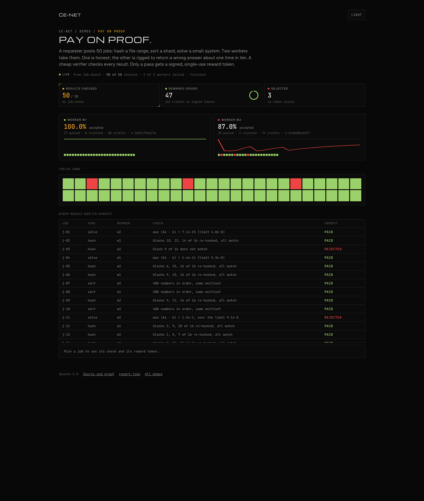

# demo-pay-on-proof

Work that pays only when it checks out. A requester posts 50 jobs: hash a file range, sort a shard,
solve a small linear system. Two workers take them. One is honest. The other is rigged to return a
wrong answer about one time in ten. Every result goes through a cheap verifier. A passing result
gets a signed, single-use reward token. A wrong result is rejected, and that worker's acceptance
rate drops live on the page.

Page (replays the committed run): https://ce-net.github.io/demo-pay-on-proof/



## What was shown (2026-11-15, seed 68)

| | Worker w1 (honest) | Worker w2 (rigged, `--cheat`) |
|---|---|---|
| Jobs checked | 27 | 23 |
| Passed and paid | 27 | 20 |
| Rejected | 0 | 3 |
| Acceptance | 100.0 % | 87.0 % |
| Credits in reward tokens | 88 | 74 |

The rigged worker's three wrong answers, one of each kind, were all caught:

| Job | Wrong answer | Caught by |
|---|---|---|
| j-03 hash | hashed the range one byte late | hash spot check: block 9 of 16 does not match |
| j-11 solve | first unknown off by 0.1 % | residual: max \|Ax - b\| = 1.3e-1, over the limit 9.1e-8 |
| j-20 sort | one number replaced by its neighbour (still in order) | permutation check: sorted, but not a permutation of the input |

- 50 results, 47 paid, 3 rejected. Every reward token verifies against the board's reward key and
  pays once; a second redeem is refused. No rejected result has a token.
- The full run report is [proof/report.json](proof/report.json): every job, which worker did it,
  the SHA-256 of its result, the verdict and check detail, and the token for each pass. The rigged
  worker's own ledger of what it got wrong is [proof/cheats.jsonl](proof/cheats.jsonl), and
  [proof/audit.txt](proof/audit.txt) is the audit of the two together.
- CI replays the run from a fresh clone with the same seed (real board, real workers, the local
  sim), requires both files to come out byte for byte the same, and runs the audit.

## Run it in under 5 minutes

Needs Rust (https://rustup.rs), Python 3.10+ and git. Every dependency is public.

```sh
git clone https://github.com/ce-net/demo-pay-on-proof && cd demo-pay-on-proof
cargo run --release -- board        # terminal 1: posts 50 jobs, live page on http://127.0.0.1:7900/
./scripts/workers.sh                # terminal 2: one honest worker, one rigged worker
```

Open http://127.0.0.1:7900/ while it runs (about 20 seconds at the default pace; `PACE=0` for
full speed). When it is done:

```sh
cargo run --release -- audit --report runs/report.json --cheats runs/cheats.jsonl   # ends with: audit ok
diff proof/report.json runs/report.json && echo same as the committed run
scripts/replay.sh                   # the CI check: both steps above, unattended
```

`workers.sh` fetches the two public repos it uses at pinned commits into `.deps/`, starts a local
ce-net sim on port 7878 (or uses one that is already running; `SIM_PORT` to change it), finds the
board there by name, and starts the workers. Another seed: `cargo run -- board --seed 9` with
`SEED=9 ./scripts/workers.sh`.

## How it fits together

```text
requester ── posts 50 jobs ──> job.board ──> tasks_open / task_take ──> worker (task-worker-loop)
                                   ^                                        |
                                   └──── task_finish(result) <──────────────┘
                                   |
                              job.check (verifier for the job's kind) ── pass ──> reward.issue ──> token
                                                                       └ fail ──> rejected, no token
```

- **Workers** are the public [ce-net-task-worker-loop](https://github.com/ce-net/ce-net-task-worker-loop)
  `worker.py`, unchanged. [scripts/pay_worker.py](scripts/pay_worker.py) imports it and only sets
  its `do_task` for the three job kinds, plus the `--cheat` flag for the demo.
- **The network** is [ce-net-local-dev-sim](https://github.com/ce-net/ce-net-local-dev-sim): the
  board lists itself there with `app_publish`, and `workers.sh` finds it with `apps_search`.
- **Reward tokens** are [ce-net-proto](https://github.com/ce-net/ce-net-proto) capability chains:
  the same Ed25519 format and offline verifier as every ce-net capability.

## The cells

Each one is a module you can reuse, and each runs on its own with one JSON request per stdin line
(`cargo run -- cell <name>`):

| Cell | Code | Does |
|---|---|---|
| `job.board` | [src/board.rs](src/board.rs) | Holds the jobs and the claims. Serves the ce-net task tools over MCP (`agent_join`, `tasks_open`, `task_take`, `task_finish`), so any ce-net worker can take jobs. One taker per job; only the taker can finish it; a result is checked once |
| `job.check` | [src/check.rs](src/check.rs) | A registry of verifiers by job kind. `hash`: re-hash 3 of 16 blocks picked by a salt the worker cannot see. `sort`: in order, same length, and the same multiset by a polynomial fingerprint at a secret point. `solve`: max \|Ax - b\| against 1e-9 (1 + max \|b\|). Each costs a fraction of doing the job. Add a kind with one more `Verifier` |
| `reward.issue` | [src/reward.rs](src/reward.rs) | Signs a token only for a passing verdict. One link: issuer the board's reward key, audience the payee, abilities `reward.redeem` and `job:<id>`, `max_credits` the pay, a nonce unique to the job. Redeeming marks the nonce spent, so a token pays once |

Check a token from the report yourself:

```sh
KEY=$(python3 -c 'import json;print(json.load(open("proof/report.json"))["reward_key"])')
TOK=$(python3 -c 'import json;print(json.load(open("proof/report.json"))["jobs"][0]["reward"]["token"])')
cargo run -q -- verify-token --key $KEY $TOK
# {"job":"j-01","payee":"…","credits":5,"nonce":…}
```

## Why the replay is exact

The jobs, the corpus file, the split of jobs between the two workers, the verifier salts, the
reward key and nonces all come from the seed, and Ed25519 signatures are deterministic. The board
offers each job to one worker by a seeded draw (worker 1 is the first to join), so the report does
not depend on which worker is faster. The rigged worker picks its wrong answers from a hash of the
seed and the job id. The report holds results only: no times, no keys, no hosts.

## Limits

- The reward key is derived from the seed so the replay is exact. A real board keeps its key
  secret, and then nobody else can mint tokens; the demo key is public by design.
- The cheats are the cheap kind: a shifted range, a swapped number, a nudged solution. A hash cheat
  that fakes only one of 16 blocks passes a 3-block spot check with probability 13/16; raise
  `samples`, or pay only after a second worker agrees, when that matters.
- Seed 68 was picked so the rigged worker's 10 % lands on each job kind once (3 of its 23 jobs).
  Other seeds give other counts; `cargo run -- plan --seed N` shows the split.
- The starter worker has no Ed25519 key of its own, so the token's audience is a 32-byte id derived
  from its agent id rather than a key it can sign with.
- The board is a local process; tokens are verified and redeemed against its own spent list, not a
  shared ledger.

## License

Apache-2.0, see [LICENSE](LICENSE). Author: Leif Rydenfalk.
